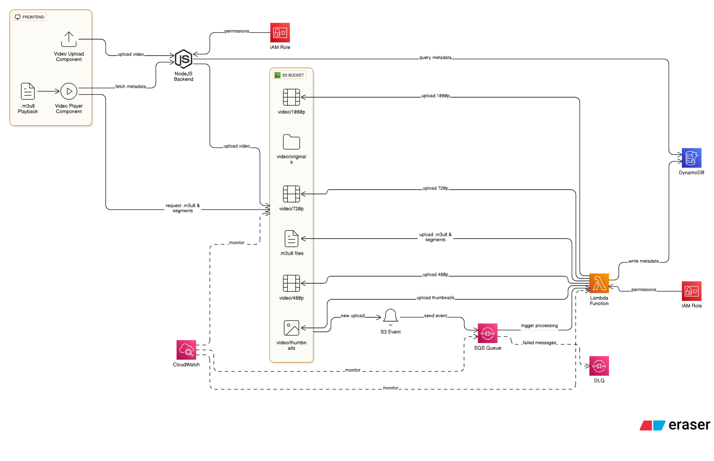
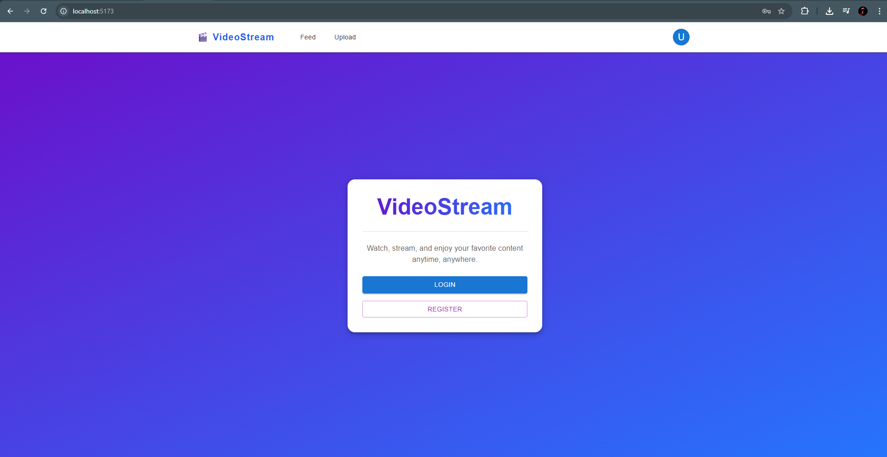
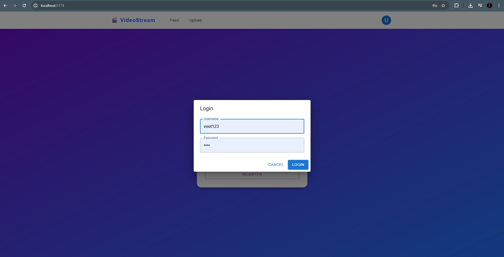
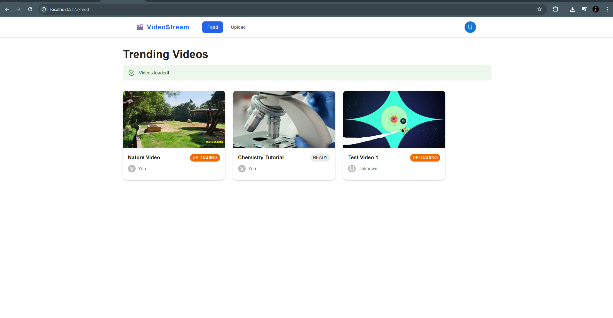
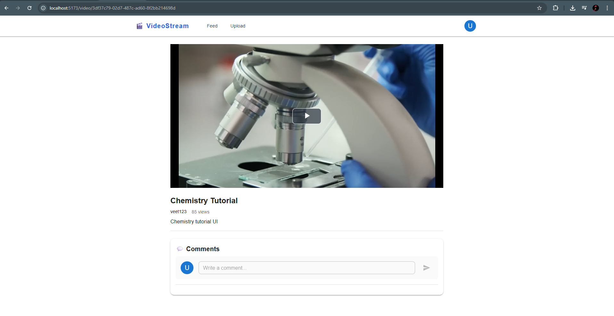
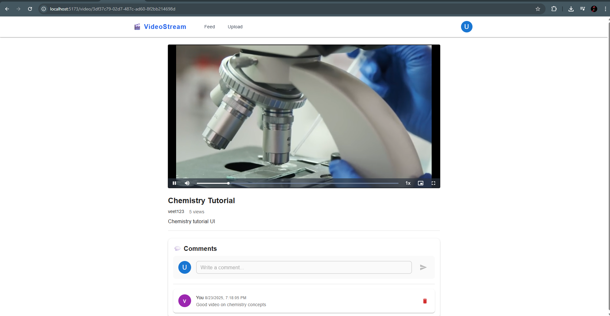
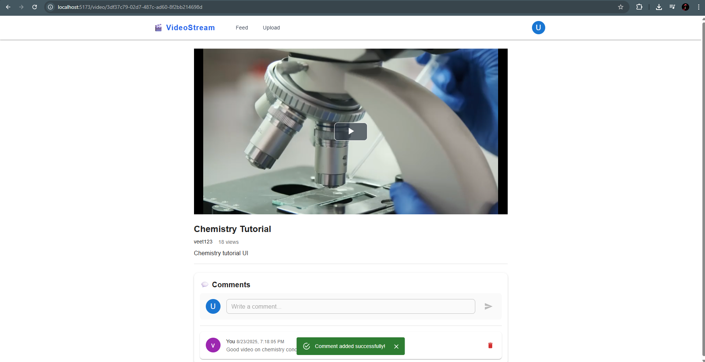
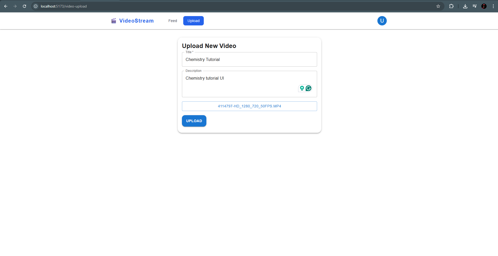
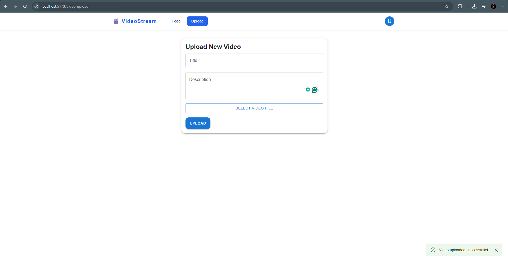
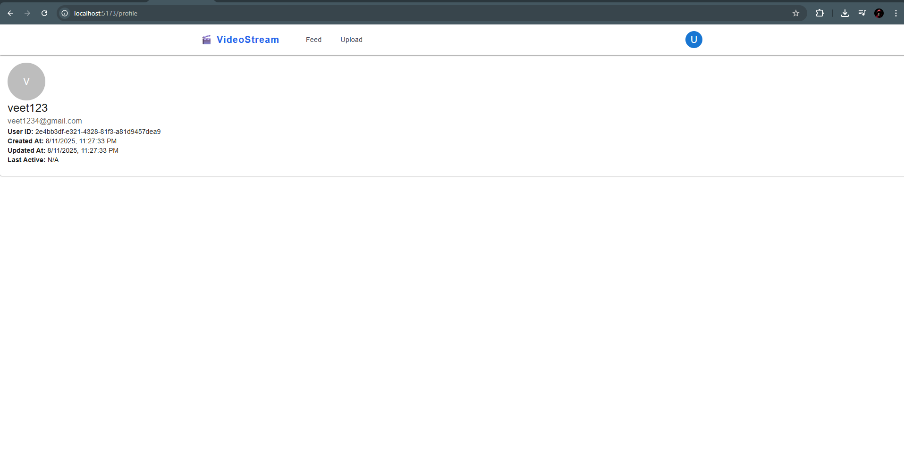

# E2E Video Streaming Platform

## Overview

This project is a full-stack, end-to-end video upload and sharing platform. It allows users to upload, share, and watch videos, with scalable cloud-native backend and a modern React frontend.

---

## Features

- User authentication (Google sign-in, email/password)
- Video upload with progress and thumbnail
- Video feed and detail pages
- User profile and "My Videos" management
- Comments on videos
- Responsive UI (MUI + Tailwind CSS)
- AWS S3 for video storage
- AWS Lambda for video processing (FFmpeg layer)
- AWS DynamoDB for metadata
- AWS SQS for event-driven processing
- GitHub Actions CI/CD for infrastructure and code


---

## Project Structure

```
├── backend/         # Express.js API, AWS integration, video upload logic
├── frontend/        # React app (Vite, MUI, Tailwind CSS)
│   ├── src/
│   │   ├── components/   # Navbar, VideoCard, VideoPlayer, etc.
│   │   ├── pages/        # Home, Feed, Upload, MyVideos, VideoDetail
│   │   └── ...
├── .github/workflows/    # GitHub Actions for AWS infra & deployment
└── README.md
```

---

## Getting Started

### Prerequisites
- Node.js 18+
- AWS account & credentials
- Yarn or npm

### Backend Setup
```sh
cd backend
cp .env.example .env # Fill in AWS and DB config
npm run dev
```

### Frontend Setup
```sh
cd frontend
npm run dev
```

### Infrastructure (AWS)
- All infra is provisioned via GitHub Actions workflows in `.github/workflows/`
- See `deploy-master.yml` for orchestrated deployment

---


## Screenshots

### Application Architecture

*A high-level overview of the platform’s architecture, showing the flow between frontend, backend, AWS services, and CI/CD pipelines.*

### Home Page

*The landing page welcomes users and highlights the platform’s core features, with options to sign in or register.*

### Login Page

*A clean and simple login dialog for user authentication, supporting Google and email sign-in.*

### Feed of Video Page

*Displays a grid of trending and recent videos from all users, allowing easy browsing and discovery.*

### Video Player Page

*A responsive video player with playback controls, showing the selected video in detail.*

### Video Detailed Play Page

*Shows the video, its description, uploader info, and related videos, providing an immersive viewing experience.*

### Video Comment

*Users can view and add comments under each video, fostering community interaction.*

### Video Upload Page

*A user-friendly form for uploading new videos, including title, description, and thumbnail selection.*

### Video Upload Success

*Confirmation screen shown after a successful video upload, with a link to view the new video.*

### Profile Page

*Displays the user’s profile information and a list of their uploaded videos for easy management.*

---

## Architecture

- **Frontend:** React + Vite + MUI + Tailwind CSS
- **Backend:** Express.js, AWS SDK
- **Storage:** S3 (videos), DynamoDB (metadata)
- **Processing:** Lambda (FFmpeg), SQS (event queue)
- **CI/CD:** GitHub Actions

---

## Future Requirements

- Video transcoding to multiple resolutions
- User roles (admin, moderator, creator, viewer)
- Video analytics dashboard
- Live streaming support
- Subscriptions and notifications
- Social features (likes, shares, follows)
- Advanced search and filtering
- Multi-language support
- Accessibility improvements
- Mobile app (React Native or Flutter)

---

## License

MIT
